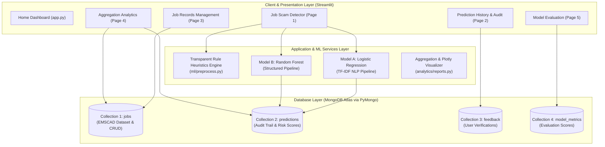

# ScamShield: AI-Powered Fake Job & Internship Detection System

**Course**: CSE494 — Intelligent NoSQL Databases  
**Project Type**: College Mini-Project / Demonstration System  
**Stack**: Python 3.11+, Streamlit, MongoDB Atlas, PyMongo, scikit-learn, pandas, NumPy, Plotly

---

## 1. Project Abstract

**ScamShield** is an intelligent, dual-engine recruitment fraud risk assessment platform built to safeguard job seekers and college students from fraudulent employment and fake internship schemes. Integrating genuine machine learning models with **MongoDB Atlas** through **PyMongo**, ScamShield evaluates recruitment listings across two distinct modalities:

1. **Linguistic NLP Modeling (Model A)**: Evaluates semantic phrasing, urgency cues, and unverified promises using TF-IDF n-gram vectorization and class-weighted Logistic Regression.
2. **Structural Attribute Modeling (Model B)**: Analyzes operational metadata—such as salary disclosure, corporate logos, applicant screening questions, education level, and upfront payment signals—using a scikit-learn preprocessing pipeline and Random Forest classification.

In addition to algorithmic risk scoring, ScamShield provides an explainable rule-based heuristic engine, full CRUD operations over job records in MongoDB Atlas, schema validation, query execution plan inspection via `.explain()`, and interactive Plotly aggregation reports.

---

## 2. Problem Statement & Motivation

Online recruitment fraud has surged significantly with the rise of remote work. Vulnerable groups, particularly university undergraduates seeking internships and entry-level positions, frequently encounter predatory postings that:
- Solicit advance payments under the guise of "training fees", "software packages", or "background screening charges".
- Direct candidates to encrypted chat platforms (Telegram, WhatsApp) for hasty interviews without corporate verification.
- Harvest sensitive personal identifiable information (SSN, government ID copies, banking routing details).

Traditional relational (SQL) databases struggle with the semi-structured, rapidly evolving nature of job postings where fields like salary ranges, requirements, benefits, and screening questions vary widely. A modern NoSQL document database (MongoDB) provides the flexible BSON document model needed for heterogeneous recruitment data, while enabling real-time aggregation and query indexing.

---

## 3. Core Objectives

- **Dual-Model ML Detection**: Implement and evaluate two genuine scikit-learn pipelines with zero hardcoded/fabricated metrics.
- **Explainable Heuristics**: Surface transparent suspicious indicators (upfront fees, cryptocurrency, unofficial email domains) alongside statistical predictions.
- **Intelligent NoSQL Integration**: Store job listings, prediction logs, end-user audit feedback, and model metadata across 4 distinct MongoDB Atlas collections.
- **Query Optimization & Analytics**: Implement compound B-tree indexes, evaluate execution plans with `.explain()`, and compute analytics via the MongoDB Aggregation Framework (`$group`, `$sort`, `$project`).
- **Interactive Multi-Page Web App**: Deliver a responsive Streamlit dashboard with dedicated pages for scam detection, prediction auditing, CRUD management, analytics, and model explainability.

---

## 4. System Architecture



---

## 5. Technology Stack

| Component | Technology | Role |
| :--- | :--- | :--- |
| **Language** | Python 3.11 / 3.13 | Core programming language |
| **Web Framework** | Streamlit 1.52+ | Responsive interactive dashboard |
| **Database** | MongoDB Atlas (M0 / Free Tier) | Cloud NoSQL document store |
| **Database Driver**| PyMongo 4.6+ | Python MongoDB connector, CRUD & Aggregations |
| **Machine Learning**| scikit-learn 1.7+ | TF-IDF, Logistic Regression, Random Forest, Pipelines |
| **Data Processing**| pandas, NumPy | Data ingestion, tabular transforms, matrix manipulation |
| **Data Visualization** | Plotly 7.1+ | Interactive charts, confusion heatmaps, distribution plots |
| **Model Persistence** | joblib | Serializing fitted scikit-learn pipelines |
| **Config & Secrets** | python-dotenv | Secure `.env` environment variable management |
| **Testing** | pytest, mongomock | Automated unit tests and mock in-memory DB tests |

---

## 6. Dataset: EMSCAD (Employment Scam Aegean Dataset)

The models and database are trained and seeded using the publicly recognized **Employment Scam Aegean Dataset (EMSCAD)** (distributed as `fake_job_postings.csv`):

- **Total Records**: 17,880 published recruitment postings.
- **Cleaned Deduplicated Records**: 15,787 entries.
- **Target Label Column**: `fraudulent`
  - `0`: Legitimate job ad (15,114 clean records, ~95.74%)
  - `1`: Fraudulent recruitment ad (673 clean records, ~4.26%)
- **Class Imbalance**: Severe real-world imbalance (~4.3% positive prevalence). Handled via `class_weight='balanced'`.

### Features Extracted:
- **Textual**: `title`, `company_profile`, `description`, `requirements`, `benefits`.
- **Structured Metadata**: `salary_range`, `has_company_logo`, `has_questions`, `telecommuting`, `employment_type`, `required_experience`, `required_education`.
- **Derived Heuristics**: `has_payment_keywords`, `desc_char_length`, `desc_word_count`.

---

## 7. Machine Learning Algorithms & Actual Results

Both models are genuinely trained on an 80/20 stratified split (`random_state=42`) using the EMSCAD dataset.

### Model A: Logistic Regression (TF-IDF NLP)
- **Pipeline**: `TfidfVectorizer(max_features=5000, ngram_range=(1,2), sublinear_tf=True)` $\rightarrow$ `LogisticRegression(class_weight='balanced', max_iter=1000)`.
- **Informational Focus**: Unigram and bigram tokens in job descriptions.
- **Actual Evaluation Metrics**:
  - **Accuracy**: `96.45%`
  - **Precision**: `0.5540`
  - **Recall**: `0.8741` *(Successfully catches 87.4% of fraudulent ads!)*
  - **F1-Score**: `0.6782`
  - **ROC-AUC**: `0.9800`

### Model B: Random Forest Classifier (Structured Metadata)
- **Pipeline**: `ColumnTransformer(OneHotEncoder + StandardScaler)` $\rightarrow$ `RandomForestClassifier(n_estimators=100, max_depth=16, class_weight='balanced')`.
- **Informational Focus**: Structural recruitment indicators (salary disclosure, company logo presence, screening questions, education).
- **Actual Evaluation Metrics**:
  - **Accuracy**: `94.62%`
  - **Precision**: `0.3952`
  - **Recall**: `0.4889`
  - **F1-Score**: `0.4371`
  - **ROC-AUC**: `0.8986`

### Academic Methodological Comparison:
1. **Asymmetric Feature Spaces**: Model A evaluates text semantics; Model B evaluates metadata completeness. In recruitment fraud, linguistic phrasing ("wire transfer", "Telegram interview", "earn $5000/week") is more informative than coarse metadata.
2. **Class Imbalance & Recall Priority**: Because missing a scam (False Negative) exposes a student to financial loss, `class_weight='balanced'` prioritizes high Recall over raw Accuracy.
3. **Data Leakage Prevention**: Transformers are fit exclusively on training folds; test folds remain completely held-out.

---

## 8. Alignment with CSE494: Intelligent NoSQL Databases Syllabus

| CSE494 Syllabus Topic | Implementation in ScamShield |
| :--- | :--- |
| **NoSQL vs. SQL** | Demonstrated via semi-structured job documents where salary ranges, screening questions, and requirements vary significantly without requiring rigid table schemas. |
| **Databases, Collections, BSON** | Four distinct collections (`jobs`, `predictions`, `feedback`, `model_metrics`) modeled using native BSON document representations. |
| **CRUD Operations** | Complete interface in `pages/3_Job_Management.py` and `database/operations.py` demonstrating `insert_one`, `insert_many`, `find`, `find_one`, `update_one` ($set), and `delete_one`. |
| **Data Modeling (Embedding vs. Referencing)** | User feedback documents in the `feedback` collection reference parent predictions by `prediction_id` (foreign key pattern), avoiding document growth limits and ensuring audit isolation. |
| **Schema Validation ($jsonSchema)** | `database/validation.py` defines BSON schema validators for each collection enforcing required fields and type constraints with `validationAction: "warn"`. |
| **B-Tree Indexing & explain()** | Unique index on `job_id` for deduplication; compound index `(predicted_class, created_at)` for sorted queries. Evaluated in real-time via PyMongo's `.explain()` in `pages/2_Prediction_History.py`. |
| **Aggregation Framework** | Real-time analytics in `pages/4_Analytics.py` using `$group`, `$sum`, `$project`, `$substrCP`, and `$sort` pipelines. |
| **PyMongo Python Integration** | Robust connection pooling, short timeout protection (`serverSelectionTimeoutMS`), bulk writes, and error handling. |
| **ML Predictive Analytics** | Genuinely trained models persist predictions and evaluation metrics directly back into MongoDB Atlas. |

---

## 9. MongoDB Schema Architecture

### Collection 1: `jobs`
```json
{
  "_id": {"$oid": "653b..."},
  "job_id": 1420,
  "title": "Software Engineering Intern",
  "company_name": "Tech Corp",
  "description": "Full job description text...",
  "requirements": "Python, MongoDB, Git...",
  "salary_range": "30000-45000",
  "has_company_logo": 1,
  "has_questions": 1,
  "telecommuting": 0,
  "employment_type": "Internship",
  "required_experience": "Entry level",
  "required_education": "Bachelor's Degree",
  "fraudulent": 0,
  "source": "EMSCAD",
  "created_at": "2026-10-19T14:00:00Z"
}
```

### Collection 2: `predictions`
```json
{
  "_id": {"$oid": "653c..."},
  "prediction_id": "PRED-4A2F8B1C9D",
  "job_title": "Remote Data Entry Clerk",
  "job_description_snippet": "Earn $5000 per week... contact via Telegram...",
  "predicted_class": "Fraudulent",
  "predicted_label": 1,
  "confidence": 0.972,
  "risk_level": "High",
  "model_name": "Logistic Regression (TF-IDF NLP)",
  "model_version": "1.0.0",
  "detected_indicators": [
    {"rule_id": "RULE-UPFRONT-PAYMENT", "rule_name": "Upfront Payment / Fee Request", "severity": "High"}
  ],
  "feedback_status": "Accurate",
  "created_at": "2026-10-19T14:05:00Z"
}
```

### Collection 3: `feedback`
```json
{
  "_id": {"$oid": "653d..."},
  "feedback_id": "FB-99E10A",
  "prediction_id": "PRED-4A2F8B1C9D",
  "user_assessment": "Accurate",
  "notes": "Verified company website; job does not exist.",
  "timestamp": "2026-10-19T14:10:00Z"
}
```

### Collection 4: `model_metrics`
```json
{
  "_id": {"$oid": "653e..."},
  "model_name": "Logistic Regression (TF-IDF)",
  "version": "1.0.0",
  "accuracy": 0.9645,
  "precision": 0.5540,
  "recall": 0.8741,
  "f1_score": 0.6782,
  "roc_auc": 0.9800,
  "training_timestamp": "2026-10-19T14:05:25Z"
}
```

---

## 10. Installation & Execution Instructions (Windows PowerShell)

### Step 1: Open Terminal and Navigate to Project Directory
```powershell
cd C:\Users\Sneha\Desktop\NOSQL
```

### Step 2: Configure Environment Variables
Copy `.env.example` to `.env`:
```powershell
Copy-Item .env.example .env
```
Open `.env` in a text editor (e.g. Notepad):
```powershell
notepad .env
```
Update `MONGODB_URI` with your MongoDB Atlas connection string:
```env
MONGODB_URI=mongodb+srv://<username>:<password>@<cluster-url>/?retryWrites=true&w=majority
DB_NAME=scamshield_db
```

> **Security Tip**: Never commit your `.env` file to Git. It is already added to `.gitignore`.

### Step 3: Verify or Download Dataset
The EMSCAD dataset is stored in `data/fake_job_postings.csv`. If needed, re-download:
```powershell
python data/download_dataset.py
```

### Step 4: Import Dataset into MongoDB Atlas (Optional)
To populate your MongoDB Atlas `jobs` collection with batch deduplication:
```powershell
# Import first 1,000 records for fast testing:
python import_data.py --limit 1000

# Or import full 17,880 records:
python import_data.py
```

### Step 5: Train Machine Learning Models
To train both models and generate evaluation metrics:
```powershell
python ml/train.py
```

### Step 6: Run Automated Test Suite
Run the 25 unit tests to verify database operations, preprocessing, and predictions:
```powershell
pytest -v
```

### Step 7: Launch Streamlit Web Application
```powershell
streamlit run app.py
```
Open your browser to: **`http://localhost:8501`**

---

## 11. MongoDB Atlas Setup Guide

1. **Sign Up**: Create a free account at [mongodb.com/cloud/atlas](https://www.mongodb.com/cloud/atlas).
2. **Create Cluster**: Select the **M0 Free Tier** cluster (AWS or GCP, closest region).
3. **Configure Database User**:
   - Go to **Security** $\rightarrow$ **Database Access**.
   - Click **Add New Database User**.
   - Select **Password Authentication**.
   - Assign role **Read and write to any database**.
4. **Configure Network Access (IP Whitelist)**:
   - Go to **Security** $\rightarrow$ **Network Access**.
   - Click **Add IP Address**.
   - Select **Allow Access from Anywhere** (`0.0.0.0/0`) for college lab / portable demo testing, or add your current IP.
5. **Get Connection String**:
   - Go to **Deployment** $\rightarrow$ **Database**.
   - Click **Connect** $\rightarrow$ **Drivers (Python, version 3.12 or later)**.
   - Copy the URI and replace `<password>` with your user password.
   - Paste into `.env` as `MONGODB_URI`.

---

## 12. Student Screenshots Checklist for Submission

When preparing your college project report or presentation slides, take screenshots of:

- [ ] **Home Dashboard (`app.py`)**: Showing the live MongoDB Atlas connection badge, total stored jobs, and Model A/B accuracy cards.
- [ ] **Job Scam Detector with Scam Input (`pages/1_Job_Scam_Detector.py`)**: Showing a high-risk scam ad, red alert banner, high confidence percentage, and detected red-flag indicators.
- [ ] **Job Scam Detector with Legitimate Input**: Showing low-risk emerald banner and normal probability.
- [ ] **Prediction History (`pages/2_Prediction_History.py`)**: Showing the table of saved predictions, user feedback submission form, and the expanded **`explain()` Query Execution Plan**.
- [ ] **Job Management CRUD (`pages/3_Job_Management.py`)**: Showing the Read table and Create/Edit form tabs.
- [ ] **Analytics & Aggregations (`pages/4_Analytics.py`)**: Showing Plotly donut chart, daily trends bar chart, and model usage distribution.
- [ ] **Model Evaluation (`pages/5_Model_Evaluation.py`)**: Showing the side-by-side metric comparison table, confusion matrix heatmaps, and top TF-IDF fraud tokens.
- [ ] **Terminal Window**: Showing the output of `pytest -v` (25 passed tests).

---

## 13. Known Limitations & Future Improvements

1. **Static Rules vs. Evolving Scams**: Keyword heuristic rules detect known patterns (crypto, Telegram, CashApp) but need continuous updates as scam syndicates alter vocabulary.
2. **Multilingual Support**: EMSCAD primarily contains English job postings; expanding to multilingual vectorization (mBERT) would improve international coverage.
3. **Company Domain Verification**: Future releases can integrate DNS lookup to programmatically verify if the hiring domain matches official corporate MX records.
4. **Independent Audit Feedback**: Current user feedback audits predictions for research, but automated retraining should require verified consensus to prevent adversarial poisoning.

---

## 14. Academic Integrity & Ethics Disclaimer

> **IMPORTANT**: ScamShield provides an **automated statistical risk assessment** based on historical recruitment patterns. It does not provide legal proof that an employer or listing is fraudulent. Job seekers must always exercise due diligence, verify employers with official corporate registries, and never send money or sensitive identification documents before a verified hiring process.
